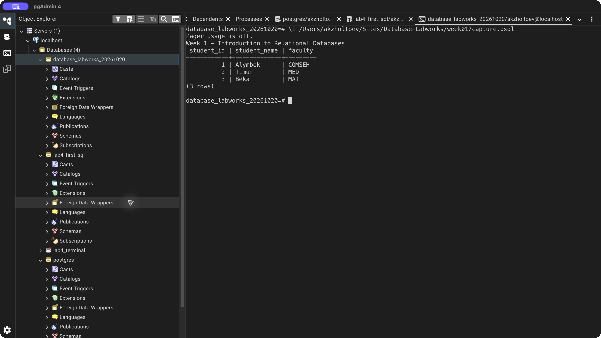

# Week 1 — Introduction to Relational Databases

A database stores organized data, and a DBMS manages it. Tables describe entities, rows store records, and columns hold attributes. Primary keys identify rows; foreign keys connect tables. The example stores three students and inspects their records, row count, and column types.

Schemas group objects, queries retrieve data, indexes support access paths, and normalization reduces duplication. Relationships can be one-to-one, one-to-many, or many-to-many. Document, key-value, wide-column, and graph databases offer other data models.

ACID means atomicity, consistency, isolation, and durability. PostgreSQL provides transactions and relational constraints for the exercises in this repository.

[SQL exercise](lab.sql) · [pgAdmin verification](verify.sql) · [Full psql output](logs/terminal.txt) · [Source lesson](https://docs.google.com/document/d/1cBOWJijltzRnv3gMqgB5YpzooXFgAG_y/edit)

## Result

[Back to all labs](../README.md)
