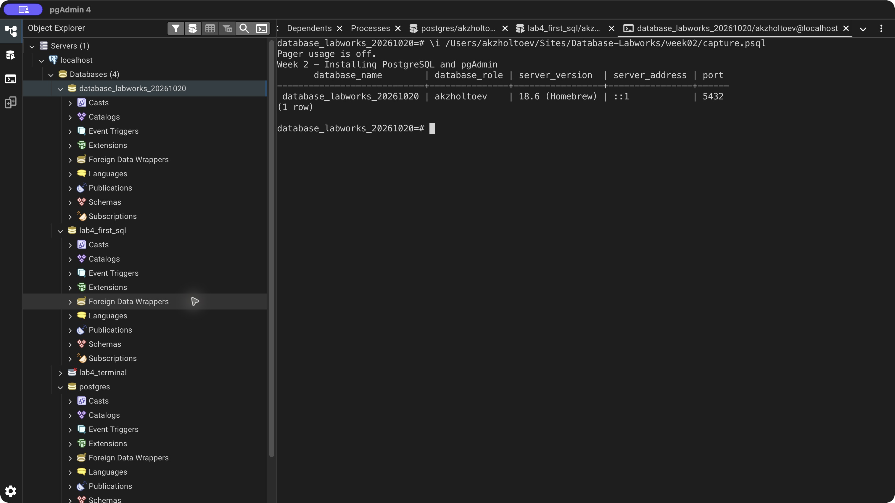

# Week 2 — Installing PostgreSQL and pgAdmin

Verified the existing Homebrew PostgreSQL 18.6 installation and connected through psql and pgAdmin 4. The server uses localhost port 5432 and the macOS database role `akzholtoev`.

The lesson's installation commands are provided for reference:

```bash
brew install postgresql
brew services start postgresql
brew install --cask pgadmin4
```

For a versioned formula, use the installed service name (here, `postgresql@18`). This run verified the existing installation with `psql --version`, `pg_isready`, and the SQL below; it did not reinstall software or reset passwords.

pgAdmin connection: host `localhost`, port `5432`, database `database_labworks_20261020`, username `akzholtoev`. Passwords are excluded from the repository.

[SQL exercise](lab.sql) · [pgAdmin verification](verify.sql) · [Full psql output](logs/terminal.txt) · [Source lesson](https://docs.google.com/document/d/1mHYboT9R0GPQhKh9muFf2Tv6AL_HQzws/edit)

## Result



[Back to all labs](../README.md)
