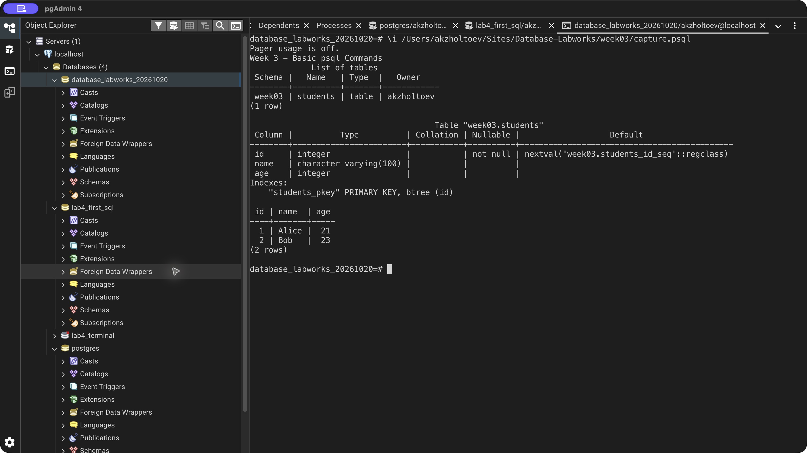
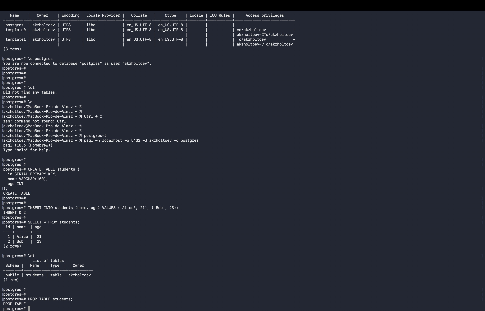

# Week 3 — Basic psql Commands

Connected with psql, listed databases with `\l`, reconnected with `\connect`, listed tables with `\dt`, inspected the student table with `\d`, and opened SELECT help with `\h SELECT`.

The table contains Alice (21) and Bob (23). A separate disposable table demonstrates DROP TABLE. In an interactive session, `\?` lists meta-commands and `\q` exits psql; the script runner exits when its file ends.

The original submitted Terminal screenshot is retained alongside the current run's full psql transcript.

[SQL exercise](lab.sql) · [pgAdmin verification](verify.sql) · [Full psql output](logs/terminal.txt) · [Source lesson](https://docs.google.com/document/d/1jPfbRCXJYQPcMFPMhifz3LVRFjCeswUB/edit)

## Result

## Original Terminal screenshot

[Back to all labs](../README.md)
