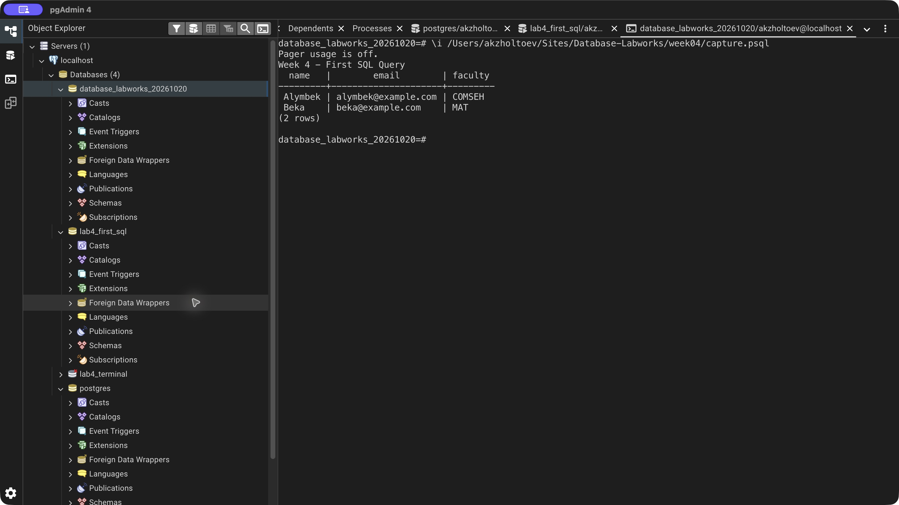
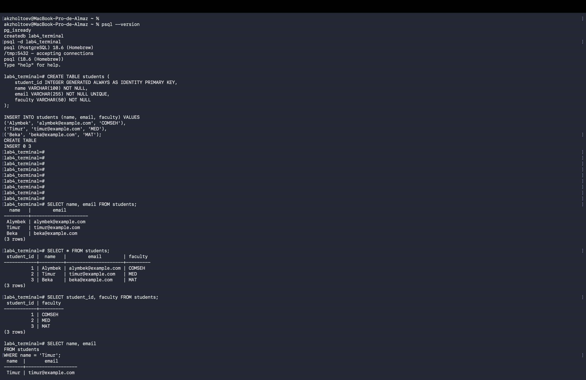
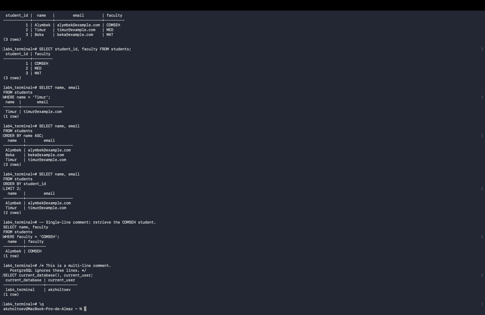

# Week 4 — First SQL Query

Created the lesson's three sample students and practiced SELECT, WHERE, ORDER BY, LIMIT, and SQL comments.

WHERE name = 'Timur' returns one row. Alphabetical sorting returns Alymbek, Beka, Timur. LIMIT 2 with student-ID ordering returns Alymbek and Timur. The incomplete `ORDER BY;` in the handout is corrected to `ORDER BY name ASC`.

The handout's COM-25 and Engineering filters correctly return zero rows because those faculties are absent from the sample data. COMSEH returns Alymbek. The pgAdmin query combines filtering, sorting, and LIMIT; the transcript includes every query. Original submission screenshots are retained.

[SQL exercise](lab.sql) · [pgAdmin verification](verify.sql) · [Full psql output](logs/terminal.txt) · [Source lesson](https://docs.google.com/document/d/10qSdz8lve4SAzF0mLsQW1yG2oGQPK1aX/edit)

## Result

## Original Terminal screenshots

[Back to all labs](../README.md)
