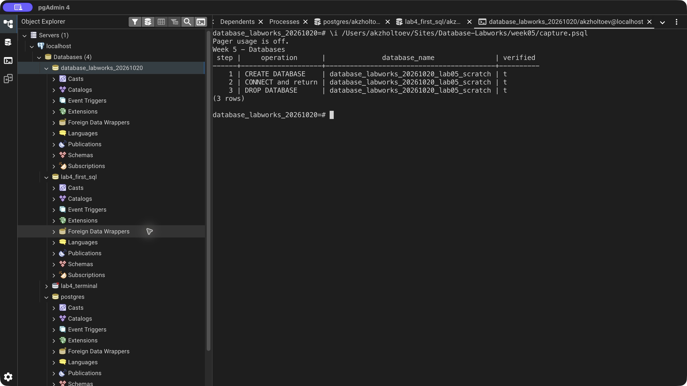

# Week 5 — Databases

Created a new scratch database, switched to it, created and queried a table, returned to the main lab database, and dropped only the scratch database. Three verified events are recorded: CREATE DATABASE, CONNECT and return, DROP DATABASE.

Names use lowercase snake_case. CREATE DATABASE and DROP DATABASE run outside transaction blocks. PostgreSQL cannot drop the current connection's database. The scratch name derives from the lab database, and a check confirms that it is absent after deletion.

[SQL exercise](lab.sql) · [pgAdmin verification](verify.sql) · [Full psql output](logs/terminal.txt) · [Source lesson](https://docs.google.com/document/d/1tACFw9v3Um6sak1ZjbQzxRur91qSvJKw/edit)

## Result

[Back to all labs](../README.md)
