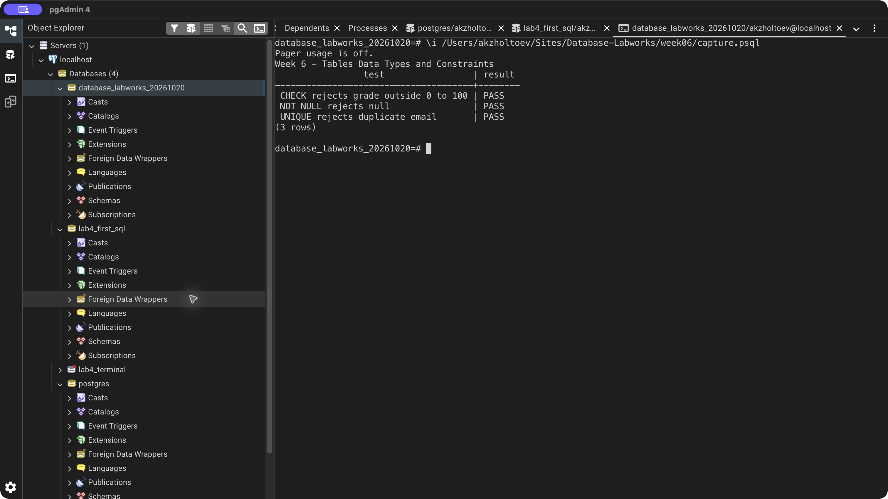

# Week 6 — Tables, Data Types and Constraints

Created a table using SERIAL, VARCHAR, NUMERIC, BOOLEAN, and DATE. Practiced ALTER TABLE to add, rename, change, and drop columns and add a CHECK constraint. Created a session-local temporary table and dropped a separate demonstration table.

PostgreSQL rejected a null first name, a duplicate email, and a grade of 101. Expected constraint violations are caught and recorded as PASS; an unexpectedly accepted insert aborts execution. The valid student rows remain available.

[SQL exercise](lab.sql) · [pgAdmin verification](verify.sql) · [Full psql output](logs/terminal.txt) · [Source lesson](https://docs.google.com/document/d/1VbzMZLRlmZaGdtf2FBgx3tjAhQRSBaNU/edit)

## Result

[Back to all labs](../README.md)
