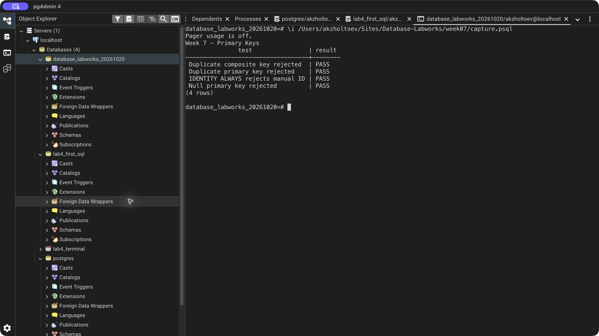

# Week 7 — Primary Keys

Demonstrated column-level, table-level, named, added, and composite primary keys. The composite enrollment key permits a course in another semester while rejecting duplicate enrollment in the same semester.

SERIAL, BIGSERIAL, GENERATED ALWAYS AS IDENTITY, and GENERATED BY DEFAULT AS IDENTITY demonstrate generated keys. BY DEFAULT accepts a supplied customer ID; ALWAYS rejects a supplied ID without an appropriate override.

Four checks verify duplicate-key, null-key, duplicate-composite-key, and IDENTITY ALWAYS behavior. The transcript also lists the automatically created primary-key indexes.

[SQL exercise](lab.sql) · [pgAdmin verification](verify.sql) · [Full psql output](logs/terminal.txt) · [Source lesson](https://docs.google.com/document/d/1dDxnTfpofoXS5KFv2CgsM0r8ZP03imXZ/edit)

## Result

[Back to all labs](../README.md)
