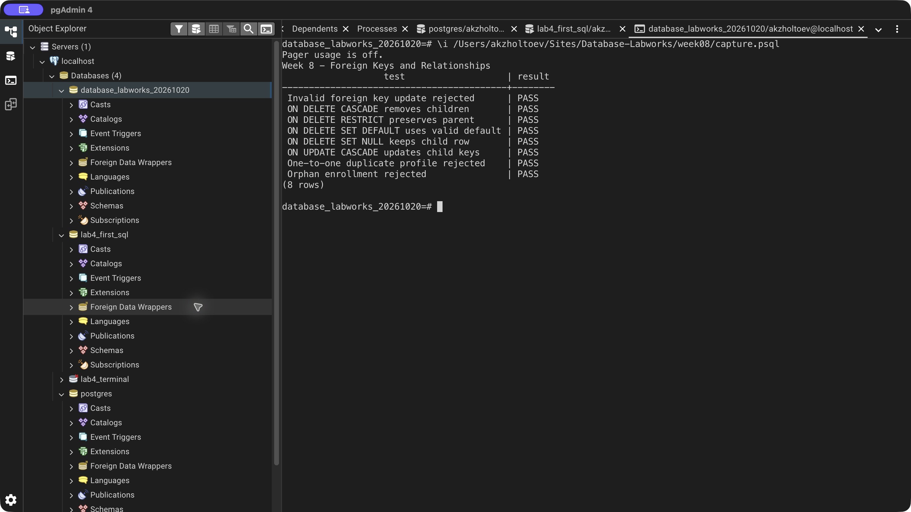
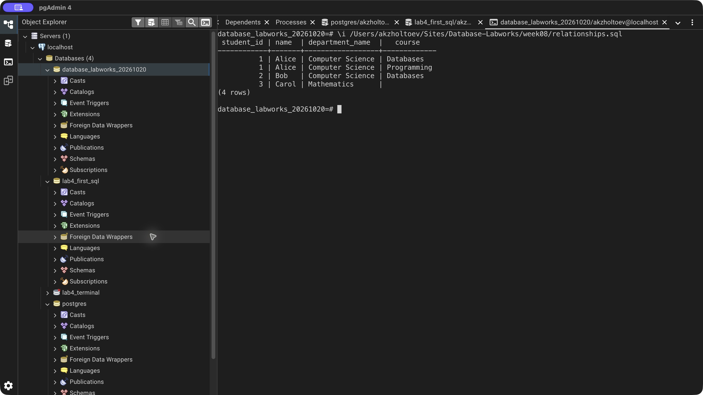
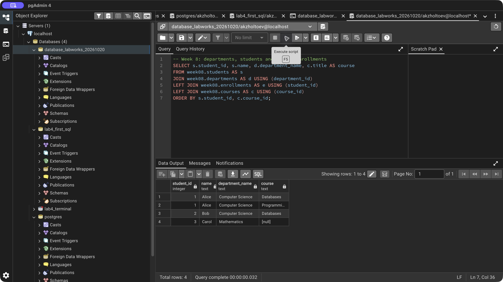

# Week 8 — Foreign Keys and Relationships

Implemented one-to-many departments and students, one-to-one profiles with shared primary keys, and many-to-many course enrollment with a junction table. Foreign keys are defined inline, as named constraints, and with ALTER TABLE.

Eight checks cover orphan insertion, invalid foreign-key updates, restricted parent deletion, one-to-one uniqueness, ON UPDATE CASCADE, ON DELETE CASCADE, ON DELETE SET NULL, and ON DELETE SET DEFAULT. Cascade demonstrations use a separate disposable student.

SET DEFAULT requires an existing referenced default row. PostgreSQL's default foreign-key action is NO ACTION; RESTRICT differs in constraint-check timing. The [relationship query](relationships.sql) displays the three remaining students and their course enrollments.

[SQL exercise](lab.sql) · [pgAdmin verification](verify.sql) · [Full psql output](logs/terminal.txt) · [Source lesson](https://docs.google.com/document/d/1HLQfBeDeBlFqEo0Z8jtA9E8YW-AmAQfw/edit)

## Result

[Back to all labs](../README.md)
