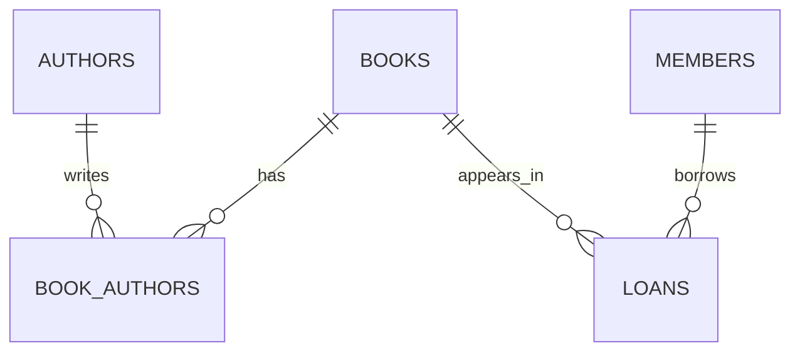

# Week 9 — Database Design Basics

Designed normalized university and library models with primary keys, foreign keys, unique constraints, and a many-to-many book–author relationship. The sample library contains two books and two loans: one active and one returned.

[SQL](lab.sql) · [Verification](verify.sql) · [Lesson](https://docs.google.com/document/d/1UjwMCGbcdKjChfTVb-8JA_Ixq6cw7IJQ/edit)

## Normalization and relationships

1NF keeps values atomic. In the enrollment table, the grade depends on the complete student–course key (2NF). Professor details are stored separately from courses, avoiding a transitive dependency (3NF). Each book record represents one lendable copy; a partial unique index prevents two active loans for the same book.

[All labs](../README.md)
